# 1. Introduction
Connect 4 is a two-player strategy game in which players take turns placing pieces into a vertical grid, with the objective of connecting four pieces horizontally, vertically, or diagonally before their opponent. As the game relies entirely on player decisions and contains no random elements, it provides a suitable environment for exploring artificial intelligence search algorithms.

The aim of this project was to develop a console-based Connect 4 game in Python while gaining a practical understanding of the Minimax algorithm, Alpha-Beta Pruning, and heuristic evaluation functions. Alpha-Beta Pruning was first introduced during university lectures, which inspired further independent study and experimentation through the development of a Connect 4 AI. Rather than focusing on graphical user interface development, the project concentrates on AI decision-making and game-state evaluation.

A custom evaluation function was developed to assess possible moves and estimate the quality of board positions. Inspired by personal experience playing Connect 4, the evaluation function prioritises immediate wins, blocking opponent threats, and creating future opportunities to achieve victory. These move evaluations are then used by the Alpha-Beta search algorithm to assist with move selection.

To balance decision quality and computational efficiency, the search depth was limited to five levels. Through the implementation and testing process, the project provided valuable insights into the challenges of designing effective evaluation functions and highlighted the difficulties of translating human strategic reasoning into a heuristic-based AI system.

# 2. Game Design and Implementation
## 2.1 System Overview
The project is implemented as a console-based Connect 4 game in Python. The game allows a human player to compete against an AI opponent. The system is organised into several modules, each responsible for a specific aspect of the game's functionality. 

The **Game** module controls the overall execution of the program and manages the main game loop. The **CheckState** module handles game state validation, including win detection, draw detection, and board state analysis. The **Evaluate** module contains the custom evaluation function used to assess move quality and board strength. The **AlphaBeta** module implements the Alpha-Beta Pruning search algorithm used by the AI to determine its moves. The **Opponent** module handles player interaction, including move input, input validation, and board updates. Finally, the **Template** module stores board templates and formatting functions used to display the game within the console. 

The project adopts a modular procedural design, with the program divided into separate files containing collections of related functions. This approach improves code organisation, readability, and maintainability while keeping the overall implementation simple. Separating functionality into dedicated modules also allows individual components, such as the evaluation function or search algorithm, to be developed and modified independently without affecting the rest of the system.

## 2.2 Board Representation and Move Management
The game maintains two separate board representations. The first, referred to as the grid, is used for internal calculations and stores board states using numerical values of -1, 0, and 1 to represent the human player, an empty position, and the AI respectively. This simplifies calculations required for win detection, board evaluation, and Alpha-Beta search operations.

The second representation, referred to as the board, stores character values 'O', '.', and 'X' for display purposes. Maintaining a separate visual representation eliminates the need for repeated formatting whenever the board is printed to the console. Both representations are updated simultaneously whenever a move is made. 


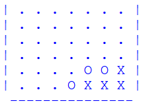

To efficiently determine where pieces should be placed, the program maintains a SlotIndex array. Each element stores the highest available row within its corresponding column. This removes the need to repeatedly search columns for empty positions and also provides a simple method for detecting full columns. 
```python
#The slotIndex for the above board sample is:
slotIndex = [5,5,5,4,3,3,3]
```

## 2.3 State Detection
After each move, the system checks whether a terminal game state has been reached. To improve efficiency, the win detection process only examines the lines that pass through the most recently placed piece rather than scanning the entire board. 

The position of the latest move is used to collect the corresponding horizontal, vertical, and diagonal lines. These sequences are then analysed to determine whether four consecutive pieces belonging to the current player exist. Since the internal game board uses numerical values, with 1 representing the AI and -1 representing the human player, a winning condition can be identified by checking whether any four consecutive positions produce a sum equal to **4 * currentPlayer**

This results in a target value of 4 for the AI and -4 for the human player. The implementation uses NumPy operations to efficiently examine all possible groups of four consecutive positions within each collected line. 

A draw is declared when no further moves can be played. This condition is determined using the SlotIndex array, where a value of -1 indicates a full column. When every element of SlotIndex equals -1, the board is considered full and the game ends in a draw.
```python
#If a board is full, there will be no more available rows:
slotIndex = [-1,-1,-1,-1,-1,-1,-1]

#The board can be checked for completion using:
finished = all( x == -1 for x in slotIndex )
```

# 3. Alpha-Beta Pruning Implementation
## 3.1 Minimax concept
The Minimax algorithm is a decision-making technique commonly used in two-player competitive games. It assumes that both players act rationally and always attempt to achieve the best possible outcome for themselves. In the context of Connect 4, the AI aims to maximise its chances of winning, while the human player is assumed to minimise the AI's chances of success. 

To determine the best move, the algorithm generates a search tree representing possible future game states. Starting from the current board position, all legal moves available to the AI are explored. Each resulting board state then generates further branches corresponding to the opponent's possible responses. This process continues recursively until a predefined search depth is reached or a terminal game state is encountered. 

Within the search tree, the AI acts as the maximising player, while the human player acts as the minimising player. At maximising levels, the algorithm selects the move that produces the highest board evaluation score. Conversely, at minimising levels, the algorithm assumes that the opponent will select the move producing the lowest evaluation score. By alternating between these two objectives, the algorithm attempts to identify the move that leads to the most favourable outcome for the AI under optimal play from both players.

A simplified representation of the search process is shown below: 
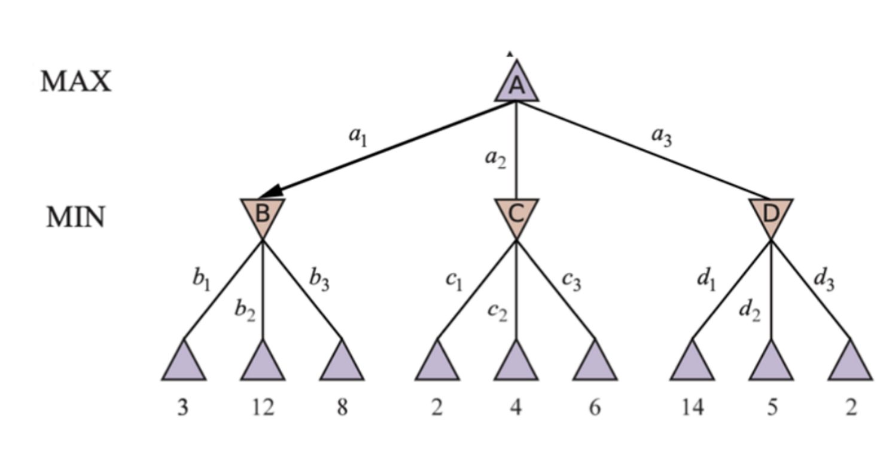
The search process terminates when either a terminal game state is reached (a player victory or draw) or the maximum search depth is reached. These evaluations are then propagated back through the search tree, allowing the AI to identify the move that maximises its expected outcome. 

## 3.2 Alpha-Beta Pruning
While the Minimax algorithm can identify strong moves by exploring future game states, the number of possible board positions grows rapidly as the search depth increases, making a full search computationally expensive.

To improve efficiency, Alpha-Beta Pruning was implemented as an optimisation of Minimax. The algorithm maintains two values throughout the search process: Alpha (α), the best score currently guaranteed for the maximising player, and Beta (β), the best score currently guaranteed for the minimising player. When a branch can no longer produce a better result than an existing alternative, it is discarded without further evaluation.


The pruning condition for the maximiser used in the implementation is: 
```python
if alpha >= beta:
    break 
```
This reduces the number of board positions that must be evaluated while preserving the same final move selection as a standard Minimax search.

Before expanding a node further, the algorithm checks whether a terminal game state has been reached. If a player has won, the search terminates and returns a large score representing the outcome, with a small depth adjustment to favour faster victories and delay unavoidable defeats. If no terminal state is reached and the maximum search depth has been exceeded, the evaluation function is used to estimate the quality of the board position.

## 3.3 Search Depth Limitation
One of the key design decisions in this project was selecting an appropriate search depth for the Alpha-Beta algorithm. Although deeper searches allow the AI to analyse more future game states, the number of possible board positions grows rapidly as each state can generate up to seven possible moves. To maintain reasonable performance and response times, the search depth was limited to five levels. 

A depth of five was chosen as a balance between computational efficiency and decision quality. This allows the AI to consider multiple future moves while still producing responses within an acceptable time. Although deeper searches may improve decision-making, the overall effectiveness of the AI also depends on the quality of the evaluation function used to score board positions. 

# 4. Evaluation Function
## 4.1 Design Objectives
The purpose of the evaluation function is to estimate the quality of a board position when a terminal game state has not been reached. The function was designed based on personal experience playing Connect 4 and aims to identify moves that increase the probability of winning while reducing opportunities available to the opponent. Rather than assigning a score directly to the board, the function evaluates each possible move and generates a score for every valid column. These scores are then used to produce an overall board evaluation for the Alpha-Beta algorithm.

## 4.2 Move Evaluation Strategy
The evaluation function uses a heuristic scoring system to analyse each possible move. Priority is given to immediate winning moves, followed by moves that prevent an opponent victory. If no immediate threats exist, the function rewards moves that create future three-in-a-row and two-in-a-row opportunities. Positions that may lead to advantageous situations for the opponent are penalised.
<p align="center">Win > Block > Three-in-a-Row > Two-in-a-Row</p>
Additional weighting is applied to the centre columns, as these positions generally provide greater flexibility for creating horizontal, vertical, and diagonal connections.

## 4.3 Board Evaluation
Rather than directly evaluating the board as a whole, the function first evaluates every valid move and generates a score for each available column. These move scores are then combined to produce an overall board evaluation, which is used by the Alpha-Beta algorithm when comparing future game states. 

# 5. Testing and Results
## 5.1 Functional Testing
The core functionality of the game was tested throughout development to ensure the system operated correctly. Tests were conducted on user input validation, player selection, game restart functionality, and game state detection. 
| Test Case | Test Data + Result | Pass? |
| --------- | ------------------ | ----- |
| Random Player to start the game | 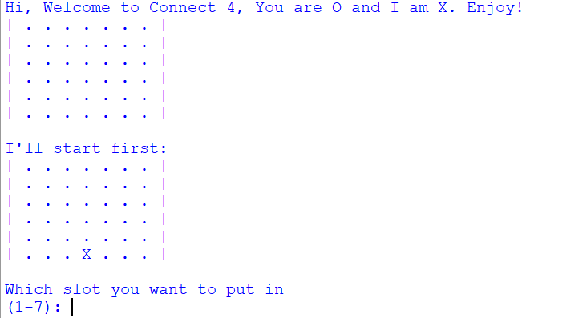 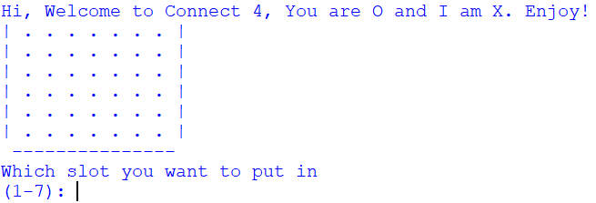 | Pass |
| Input for moves | User input for numbers between 1 and 7 inclusively leads to the correct entry on the board | Pass |
| Validate input for moves | 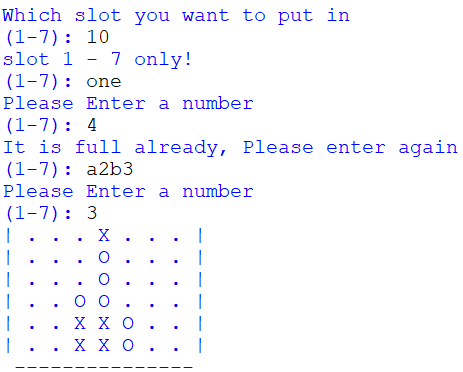 | Pass |
| Validate input and stopping the game loop | 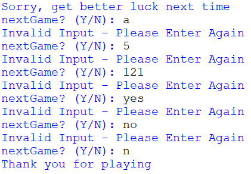 | Pass |
| Input to restart game | 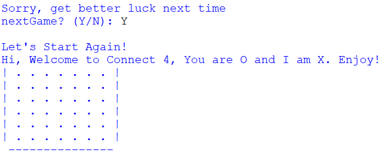 | Pass |
| Horizontal win detection | 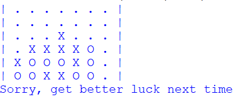 | Pass |
| Vertical win detection | 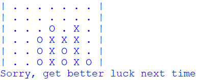 | Pass |
| Diagonal win detection | 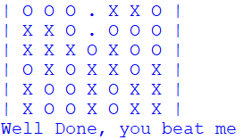 | Pass |
| Draw detection | 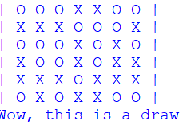 | Pass |

The testing results indicate that the core game mechanics were implemented successfully. Input handling, game state management, win detection, draw detection, and restart functionality all behaved as expected during testing. No critical issues were identified in the fundamental gameplay mechanics, allowing development efforts to focus primarily on improving the AI decision-making process. 

## 5.2 Results and Limitations 
During testing, the AI was able to complete games successfully using the Minimax and Alpha-Beta algorithms. In most situations, it correctly identified immediate winning opportunities, blocked obvious threats, and occasionally created positions that led to future victories. This suggests that the search algorithm and evaluation function were generally operating as intended. 

However, some limitations were observed during gameplay. On a small number of occasions, the AI selected moves that appeared strategically questionable from a human perspective and, in two observed cases, indirectly created opportunities for the opponent to win within the following one or two turns. Although these situations were rare,  they indicate that the AI does not always select the strongest available move. 

It was also observed that increasing the search depth did not always improve performance. In several matches, a search depth of three appeared to produce more reasonable moves than a depth of five. A possible explanation is that the current evaluation function places too much emphasis on attacking opportunities while not weighting defensive considerations strongly enough. As a result, deeper searches may reinforce long-term attacking plans that appear beneficial to the evaluation function but are not always the most effective practical moves. Further testing and refinement of the evaluation function will be required to improve decision quality. 

# 6. Future Improvements
Several improvements have been identified that could enhance both the gameplay experience and the quality of the AI. The following areas are considered the most promising for future development. 
* **Additional game modes**: including Human vs Human and AI vs AI gameplay. An AI vs AI mode would be particularly useful for observing and comparing decision-making strategies. 
* **Difficulty settings**: which could be implemented by varying the Alpha-Beta search depth or simplifying the evaluation heuristics for easier levels.
* **Evaluation function refinement**: with a greater focus on balancing offensive and defensive decision-making. This was identified as the most important area for future improvement during testing.
* **Graphical user interface (GUI) development**: replacing the current console-based interface to improve usability and provide a more engaging playing experience. 

Implementing these improvements would provide a stronger playing experience while also creating additional opportunities to investigate and improve the AI's behaviour. 

# 7. Conclusion
This project successfully implemented a console-based Connect 4 game featuring an AI opponent powered by the Minimax algorithm and Alpha-Beta Pruning. The primary aim of the project was not only to develop a playable game, but also to gain a practical understanding of artificial intelligence search algorithms and how they can be applied to a competitive game environment.

Through the implementation process, a custom evaluation function was designed to assess board positions and guide the AI's decision-making. One of the most valuable lessons learned during the project was that designing an effective evaluation function is significantly more challenging than implementing the Alpha-Beta algorithm itself. Although the search algorithm was able to explore future game states efficiently, the quality of the AI's decisions ultimately depended on how accurately the evaluation function reflected strong Connect 4 strategy.

Testing showed that the AI was capable of identifying winning opportunities, blocking threats, and completing games successfully. However, the project also highlighted the difficulties involved in balancing offensive and defensive considerations within a heuristic-based evaluation system. These observations provided valuable insight into the limitations of game AI and the importance of continuous testing and refinement.

Overall, the project achieved its main objectives by providing a deeper understanding of Minimax search, Alpha-Beta Pruning, and heuristic evaluation. It also demonstrated how theoretical concepts introduced in university lectures can be applied to a practical software project, while creating opportunities for further development and improvement in the future.
